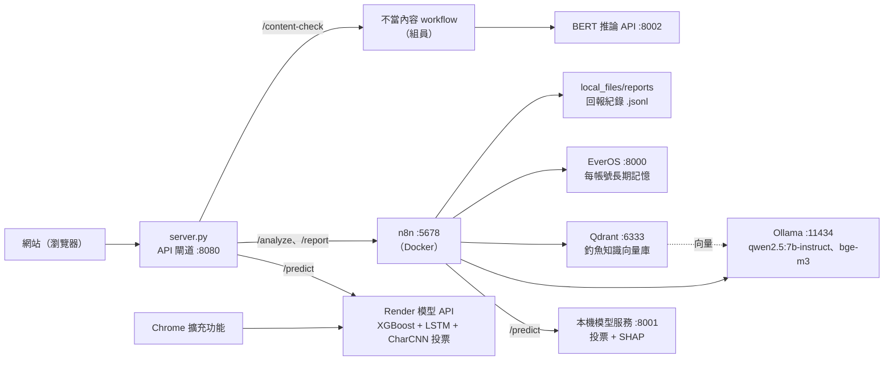

# PhishGuard AI（URLock）：釣魚網址偵測的系統整合

用三個機器學習模型投票判斷網址是不是釣魚網站，再由本機 LLM 依判定結果說明原因、回答資安問題，並記住每個使用者問過的網址。

這是大學專題的**系統整合與後端**部分：模型由組員訓練，我負責把模型部署成服務，並用 API 閘道、n8n 自動化流程、向量資料庫、長期記憶與本機 LLM 串成可以從網站使用的系統。

## 系統架構



網站的請求都先到 `server.py`：網址檢測轉到 Render，問答、網址分析與回報轉到 n8n。n8n 再呼叫本機模型服務、Ollama、Qdrant、EverOS，並把回報寫進本機資料夾。

---

## 我負責的部分

| 項目 | 我做的事 |
|---|---|
| 模型部署（Render） | 用 FastAPI 把三個模型包成推論 API；修正兩個讓模型失效的錯誤；前處理和組員規格逐一比對到分數完全相同 |
| API 閘道 `server.py` | 只用 Python 標準函式庫，提供網頁並轉發 4 組 API，含輸入驗證、逾時與錯誤處理 |
| n8n workflow（3 個） | 問答與網址分析、EverOS 長期記憶、使用者回報；JavaScript Code 節點與 prompt 設計 |
| LLM 與 RAG | Ollama 跑 qwen2.5:7b-instruct；Qdrant + bge-m3 建立釣魚知識庫 |
| 長期記憶 | 串接 EverOS v2 API，以帳號區分記憶 |
| BERT 推論 API | 把組員微調的 bert-base-uncased 包成 GPU 推論服務 |
| 網站介接 | 模擬登入、網址分析按鈕、回報功能、「無法判定」狀態（介面設計不是我做的） |

**組員負責**：三個網址模型與 BERT 的訓練、判定流程規格（`0805_three_model_workflow.md`）、網站與擴充功能的介面設計、不當內容檢測中的 Gemini／Jina Reader／Firecrawl 串接。

模型 API 的程式在另一個 repo：[D1249330/n8n_local_model_university](https://github.com/D1249330/n8n_local_model_university)。

---

## 判定方式

依組員的規格文件實作，只多一條規則：先拿掉網址開頭的 `www.`。

1. 拿掉開頭的 `www.`（含 `www1.`、`www[.]`），協定、路徑、參數都保留。
2. 三個模型各自清理網址、各自推論：

   | 模型 | 前處理 | 門檻 |
   |---|---|---|
   | XGBoost（23 個網址特徵） | 還原 `[.]` → 拿掉任何協定 → 轉小寫 → 去掉非 ASCII | 0.26 |
   | LSTM（字元序列） | 還原 `[.]` → 拿掉 `http(s)://` → 轉小寫 → 去掉非 ASCII | 0.43 |
   | CharCNN（字元序列，ONNX） | 只拿掉 `http(s)://`，不轉小寫 | 0.40 |

3. 每個模型的機率 ≥ 門檻得 1 票；**至少 2 票判為釣魚**。任一模型沒有結果時不判定（`unknown`）。
4. **LLM 不能推翻判定**：結論句由 n8n 的 Code 節點依票數產生，LLM 只負責說明跡象與給建議。

---

## API 範例

```bash
curl -X POST https://n8n-local-model-university.onrender.com/predict \
  -H 'Content-Type: application/json' \
  -d '{"url":"https://paypa1-secure-login.verify-account.xyz/signin.php"}'
```

```json
{
  "url": "https://paypa1-secure-login.verify-account.xyz/signin.php",
  "is_phishing": true,
  "confidence": 1.0,
  "verdict": "phishing",
  "scores": { "xgb": 0.9999, "lstm": 0.9999, "cnn": 1.0 },
  "votes":  { "xgb": 1, "lstm": 1, "cnn": 1 },
  "reasons": [
    "主機名稱含有連字號 (-)",
    "使用高風險頂級域名（.sbs / .xyz…）",
    "含有敏感關鍵字（login / verify / bank…）"
  ],
  "model_input": {
    "xgb": "paypa1-secure-login.verify-account.xyz/signin.php",
    "lstm": "paypa1-secure-login.verify-account.xyz/signin.php",
    "cnn": "paypa1-secure-login.verify-account.xyz/signin.php"
  }
}
```

| 欄位 | 說明 |
|---|---|
| `verdict` | `phishing`／`safe`／`unknown` |
| `confidence` | 判為釣魚的模型數 ÷ 3（0、0.33、0.67、1） |
| `scores`／`votes` | 各模型的機率，以及和門檻比較後的 0／1 |
| `model_input` | 各模型實際收到的字串，用來排查前處理問題 |

其他端點：`GET /health`（模型版本、已載入模型、門檻）、`POST /predict/batch`（`{"urls": [...]}`，最多 20 個）。

---

## Repo 結構

```
phishguard-integration/
├── server/server.py            API 閘道（Python 標準函式庫）
├── n8n/
│   ├── phish_cp.json           問答與網址分析（webhook: deep-forensics）
│   ├── everos_database.json    EverOS 長期記憶子流程
│   ├── feed_back.json          使用者回報（webhook: phishguard-report）
│   └── code/                   上面三個 workflow 的 Code 節點，拆成 .js 方便閱讀
├── prompts/                    7 個 AI Agent 的 prompt 範本
├── docker/
│   ├── docker-compose.yml      n8n、Qdrant、Ollama、Postgres
│   └── .env.example
└── tests/
    ├── code_nodes.test.mjs     Code 節點單元測試（10 個案例）
    └── curl_examples.sh        各服務的 curl 驗證指令
```

---

## 部署與啟動

**1. 模型 API（Render）**：模型 repo push 到 GitHub 後，Render 依 Dockerfile 自動建置部署。部署後確認：

```bash
curl https://n8n-local-model-university.onrender.com/health
# {"status":"ok","model_version":"0802-md-www","models_loaded":["xgb","lstm","cnn"], ...}
```

免費方案閒置 15 分鐘會休眠，第一次請求要等 30–60 秒。

**2. n8n、Qdrant、Ollama**

```bash
cd docker
cp .env.example .env            # 填入自己的密碼與金鑰
docker compose up -d
docker exec ollama ollama pull qwen2.5:7b-instruct
docker exec ollama ollama pull bge-m3
```

**3. 匯入 workflow**：在 n8n 介面 Import from File，依序匯入 `n8n/everos_database.json`、`n8n/feed_back.json`、`n8n/phish_cp.json`。

- 匯入後重新設定 Ollama 與 Qdrant 的憑證。
- 在 `phish_cp` 的 Execute Workflow 節點重新選擇 EverOS_database。
- 把三個 workflow 切成 Active。

**4. 建立知識庫**：`phish_cp` 裡的 RAG 區塊依序是 Default Data Loader → Character Text Splitter（500 字、重疊 50）→ Embeddings Ollama（bge-m3）→ Qdrant Vector Store（insert）。上傳釣魚知識的純文字檔即可建庫，目前共 34 筆、1024 維、Cosine。

**5. 主機上的服務**：EverOS（:8000）與本機模型服務（:8001）跑在主機上，n8n 透過 `host.docker.internal` 連線。

**6. API 閘道**

```bash
python3 server/server.py        # 開在 http://localhost:8080
```

`server.py` 會提供同一層 `web/` 資料夾裡的網站。網站前端由組員設計，不在這個 repo。可用環境變數覆寫各後端網址：`PHISHGUARD_API`、`N8N_WEBHOOK`、`N8N_REPORT_WEBHOOK`、`N8N_CONTENT_WEBHOOK`、`PORT`。

---

## n8n workflow 說明

`phish_cp` 依使用者輸入分成三條路：

| 路徑 | 什麼時候 | 流程 |
|---|---|---|
| url | 只有網址 | 模型服務 → 依投票產生報告（含 XGBoost SHAP 的白話跡象）→ LLM 說明 → 程式組結論 |
| url_chat | 網址加提問 | 模型服務 → 報告 → LLM 抽關鍵字 → Qdrant + EverOS 檢索 → LLM 回答 → 結論只說「是／不是釣魚網址」 |
| chat | 一般問題 | LLM 抽關鍵字 → Qdrant + EverOS 檢索 → LLM 回答 |

- 每次回答後，由 `everos_database` 子流程把「問題＋回答」存進 EverOS（add → flush），下次就搜得到。
- `feed_back` 把使用者回報先轉成 base64，再交給 Execute Command 追加到 `.jsonl`，避免描述裡的引號或 `$(...)` 被當成 shell 指令執行。

---

## 測試

```bash
node --test tests/code_nodes.test.mjs    # Node.js 18 以上，不需安裝套件
bash tests/curl_examples.sh              # 需要各服務都已啟動
```

`code_nodes.test.mjs` 直接讀 `n8n/phish_cp.json` 裡的程式，用假資料驗證：

- 網址分流：url／url_chat／chat，以及 `[.]` 去武裝寫法。
- `www.` 處理。
- 1／2／3 票與「無法判定」的結論。
- LLM 回答「可疑」「建議改密碼」時會被濾掉。
- LLM 回空白時流程不會壞。

---

## 除錯紀錄

**三個模型，其實只有兩個在投票**
API 上線後結果不太合理。逐一檢查每個模型的輸入，發現 LSTM 模型第一層要的是字串，舊程式卻送整數編碼，每次預測都失敗而被靜默略過。另外 CharCNN 匯出 ONNX 時的網路結構和訓練時不同，任何網址的分數都落在 0.3–0.5。修正後重新轉檔，ONNX 與 PyTorch 輸出最大差異 6×10⁻⁸，上線環境也因此不必安裝 PyTorch。

**同一個網址，兩個頁面分數不同**
同一個 YouTube 網址，網址檢測顯示 42%，問答頁顯示 52%。比對實際送進模型的字串後，發現問答把「網址＋換行＋是釣魚網站嗎?」整段當成網址送進模型。改成只取出網址本身，兩邊一致。這也是 API 回傳 `model_input` 欄位的原因。

**`www.` 讓正常網站被判成釣魚**
`google.com` 的 LSTM 分數是 0.0005，`www.google.com/` 卻是 0.83。改成先拿掉開頭 `www.` 之後，YouTube、Google 等原本被判為釣魚的正常網址降到 0–1 票，釣魚測試網址仍是 3／3 票。根本解法是重新訓練，讓正常樣本也包含 `www.` 與路徑。

**不讓 LLM 推翻模型**
只有 1／3 票判為釣魚的正常網址，LLM 卻說成「可疑」，還建議使用者修改密碼。改成由 Code 節點依投票產生結論，LLM 只寫說明，並過濾和判定方向相反的字眼。另外，qwen2.5:7b 常直接輸出 JSON 文字，而不呼叫 n8n Structured Output Parser 要求的工具，導致「empty response」錯誤。後來移除 Parser，改由程式自行解析。

**和規格逐位比對**
用組員的參考腳本比對雲端 API、本機服務與參考腳本，三個模型的分數完全相同；也確認 XGBoost 的 `.pkl` 與 `.ubj` 兩種模型檔輸出一致（800 棵樹，差異 0）。

---

## 已知限制

- `youtu.be` 這類短網址分享連結仍會被三個模型判為釣魚，需要重新訓練。
- 判斷依據只有 XGBoost 有（SHAP）；LSTM 與 CharCNN 沒有可解釋的依據。
- 模型 API 與 `server.py` 沒有身分驗證與限流；網站登入是模擬登入。
- n8n、Ollama、EverOS、BERT 都在本機，需要 NVIDIA GPU。

## 技術

Python · FastAPI · XGBoost · Keras · ONNX Runtime · Hugging Face Transformers · SHAP · n8n · Ollama · Qwen2.5-7B-Instruct · bge-m3 · Qdrant · EverOS · Docker Compose · Render · JavaScript
